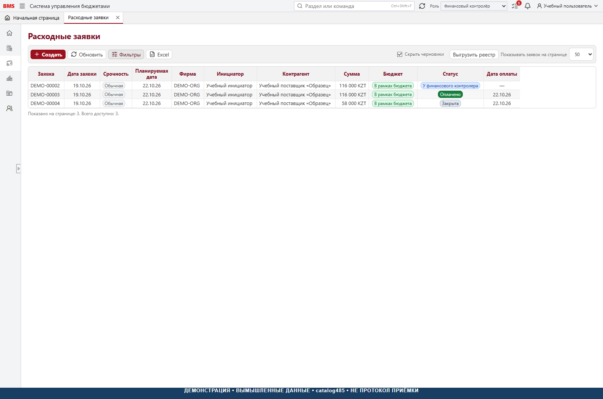

# BMS 1.0

Budget Management System - система управления бюджетами компании.

> [!IMPORTANT]
> **Штатный обмен с 1С пока не реализован.**
> HTTP/OData/файловый адаптер, новый издатель и полный установщик витрины
> требуют разработки. Это первый исходный выпуск для изучения и адаптации,
> а не готовый дистрибутив для рабочего внедрения.

## Для кого и для чего

BMS предназначена для финансовых директоров, финансовых контролёров,
владельцев бюджетов, казначейства и бухгалтерии компаний, которым нужен
единый управленческий процесс: согласовать бюджет, проверить лимит перед
расходом, согласовать заявку, подтвердить оплату и проконтролировать первичку.

Система связывает бюджеты ЦФО, расходные заявки, управленческие начисления
и закрывающие документы. Это отдельный управленческий контур, а не замена
бухгалтерии, банка или учётной системы. Разработчикам и интеграторам доступны
исходники интерфейса, сервера и SQL-схемы для собственной установки.

[Руководство](docs/USER_GUIDE.md) · [Установка](docs/INSTALLATION.md) ·
[Возможности и ограничения](docs/FEATURES_AND_LIMITATIONS.md) ·
[Скриншоты](docs/SCREENSHOTS.md) · [Лицензия](LICENSE.md)

Веб-интерфейс, серверная бизнес-логика и SQL-скрипты для бюджетов ЦФО,
расходных заявок, согласования, управленческих начислений и контроля первичных
документов. Учётная система остаётся отдельным источником справочников и факта.

## Статус первого исходного выпуска

Это исходный выпуск версии 1.0 на основе среза catalog485.
Правообладатель - Джабаев Бисемби. Лицензия BMS Community License 1.0 и
политика SECURITY.md утверждены владельцем. Правообладатель разрешил
публичное размещение этой редакции. Статус выпуска — Pre-release;
полная приёмка новой установки не завершена.
Этот каталог нельзя считать готовым
дистрибутивом для рабочего внедрения: комплект интеграции требует завершения
и проверки в инфраструктуре новой установки.

В состав не входят базы данных, резервные копии, сотрудники, бюджеты компании,
контрагенты, учётные данные, тестовые проекты и история разработки.
Встроенные инструкции заменены нейтральными краткими памятками.
Полный комплект руководств со скриншотами находится в каталоге docs.

Целевая схема интеграции —
штатный сервис или выгрузка средствами платформы 1С → отдельная витрина BMS.
**Готовый новый адаптер получения данных и публикации витрины не поставляется.**
Импорт факта, загрузка справочников и автоматическое подтверждение оплат
требуют реализации адаптера и приёмки; смена документации их не реализует.
Подробности: [штатный обмен](docs/INTEGRATION_GUIDE.md).



## Документация

- [Оглавление всего комплекта](docs/README.md).
- [Полное руководство по бизнес-процессам](docs/USER_GUIDE.md).
- [Единый справочник для локального чтения и печати](docs/guide.html).
- [20 скриншотов с вымышленными данными](docs/SCREENSHOTS.md).
- [Архитектура и исходные компоненты](docs/ARCHITECTURE.md).
- [Что реализовано и какие есть ограничения](docs/FEATURES_AND_LIMITATIONS.md).
- [Установка](docs/INSTALLATION.md), [эксплуатация](docs/OPERATIONS.md),
  [интеграция с 1С](docs/INTEGRATION_GUIDE.md).
- [Приёмочные сценарии](docs/ACCEPTANCE.md), [подготовка публикации](docs/PUBLICATION_CHECKLIST.md).
- [Лицензия](LICENSE.md), [политика безопасности и сообщения об уязвимостях](SECURITY.md).

Скриншоты используют только вымышленные данные и не доказывают серверную
приёмку. В некоторых процессах catalog485 отличается от раннего ТЗ;
эти различия отмечены явно. Интерфейс использует нейтрально-серую тему.

## Стек

- Фронтенд: React 19.2.8, TypeScript 7.0.2, Vite 8.2.4.
- Бэкенд: C# и .NET 10; SDK 10.0.302, runtime 10.0.13.
- Хранилище: Microsoft SQL Server, основная схема `bms_web` и отдельная реплика.
- Вход: Windows Authentication. Роли BMS назначаются отдельно от групп Windows.

## Состав

| Каталог | Назначение |
| --- | --- |
| `frontend` | Исходники веб-интерфейса и фиксированные зависимости |
| `backend` | API, прикладная и доменная логика, доступ к SQL |
| `database` | Основные миграции, расширения и контрольные хеши |
| `setup` | Установщик новой пустой основной БД |
| `integrations` | Недельные напоминания и чтение собственной витрины BMS |
| `ops` | Ограниченные операторские SQL-инструменты; не запускать автоматически |
| `docs` | Требования к новой установке и протокол проверки |

## Сборка

Установите указанный .NET SDK и Node.js, совместимый с закреплённой версией Vite.
Для установочных команд нужен PowerShell 7. Команды выполняются в новой
локальной копии репозитория.

До сборки проверьте состав исходного архива:

```powershell
./setup/Test-BmsSourcePackage.ps1
```

Команда сверяет каждый файл с `source-manifest.json`, не подключаясь к серверам.
После локального изменения исходников хеши закономерно изменятся. Проверка
целостности не является проверкой бизнес-функций или разрешением на публикацию.

```powershell
dotnet build backend/Bms.Backend.slnx -c Release
Push-Location frontend
npm ci
npm run build
Pop-Location
```

Публикация сервера:

```powershell
dotnet publish backend/src/Bms.Api/Bms.Api.csproj -c Release -o build/service
```

Тестовые проекты в состав решения не включены. Это не отменяет приёмочных
проверок перед внедрением и не означает, что сборка подтверждает бизнес-сценарии.

## Первичная установка

1. Используйте отдельный SQL Server и новую пустую БД. Не направляйте установщик
   в бухгалтерскую базу, базу витрин или существующую BMS.
2. Запустите `setup/New-BmsDatabase.ps1` с новым именем, начинающимся с `Bms_`,
   и заранее созданным каталогом данных, доступным службе SQL Server.
3. Установщик проверяет хеши SQL, отказывается изменять существующую БД и
   создаёт уникальный признак владения. Повторный запуск на том же имени
   останавливается. Автоматического удаления или восстановления БД нет.
4. Выполните `setup/Initialize-BmsAdministrator.ps1` с маркером этой установки
   и явно выбранной Windows-учётной записью первого администратора.
   Затем настройте отдельную служебную учётную запись, сотрудников и роли BMS.
   Не запускайте API от `sysadmin`, DBA или учётной записи установщика.
5. Завершите настройку реплики, обмена, вложений и входа по инструкции
   `docs/INSTALLATION.md`.
6. Снимите режим обслуживания только после проверки прав и сквозных сценариев.

Пример команды для отдельного локального экземпляра:

```powershell
./setup/New-BmsDatabase.ps1 -Database Bms_NewInstallation `
  -Server 'lpc:.\BMSLOCAL' -DataDirectory 'C:\BmsNew\sql-data'
```

Временный `-TrustServerCertificate` допустим только для осознанной локальной
проверки. Для рабочей установки настройте доверенный сертификат SQL Server.
По умолчанию рост БД ограничен 512 МБ данных и 256 МБ журнала. Для внедрения
DBA выбирает размеры через `-DataMaxSizeMb` и `-LogMaxSizeMb`, исходя из диска
и ожидаемой истории данных. Вложения хранятся отдельно.

## Лицензия

Применяется [BMS Community License 1.0](LICENSE.md): бесплатное внутреннее
использование, включая компании, бесплатные форки с сохранением авторства
и условий, платная работа по установке, настройке и доработке разрешены.
Продажа самой BMS, её переименованных версий и платный доступ к функциональности
как к сервису запрещены без отдельного письменного разрешения правообладателя.

Это source-available, а не лицензия на неограниченное коммерческое распространение.
Полные условия — в LICENSE.md; уведомление об авторстве — в [NOTICE.md](NOTICE.md).
Сторонние компоненты лицензируются отдельно. Одобрение лицензии не является
разрешением фактической публикации или подтверждением готовности к внедрению.
