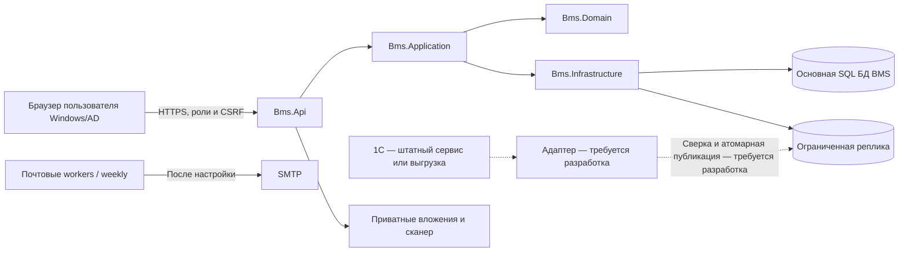

# Архитектура BMS

## Компоненты

Это логическая схема зависимостей. Она не выдаёт сетевых прав и не означает,
что все компоненты автоматически запускаются из архива. Пунктир обозначает
целевой обмен, который в этой версии ещё не реализован. Реплика — собственная
витрина BMS. Её полный установщик и издатель требуют отдельной реализации
и приёмки.

## Исходные проекты

| Компонент | Путь | Ответственность |
| --- | --- | --- |
| React / TypeScript | [frontend/src](../frontend/src) | Формы, навигация, роли интерфейса, публичные декодеры API |
| API | [Bms.Api](../backend/src/Bms.Api) | HTTP, Windows-вход, CSRF, ограничения, маршруты, workers |
| Application | [Bms.Application](../backend/src/Bms.Application) | Транзакционные команды, авторизация процесса, идемпотентность, аудит |
| Domain | [Bms.Domain](../backend/src/Bms.Domain) | Статусы, суммы, маршруты, бюджетные и закрывающие правила |
| Infrastructure | [Bms.Infrastructure](../backend/src/Bms.Infrastructure) | SQL/EF, реплика, файлы, почтовые и временные адаптеры |
| SQL | [database](../database) | Основные миграции, расширения, хеши |
| Локальные обработчики | [integrations](../integrations) | Недельные напоминания и чтение расшифровок собственной витрины |

Точные версии: React 19.2.8, TypeScript 7.0.2, Vite 8.2.4; .NET SDK 10.0.302,
runtime 10.0.13. Источники версий — [package.json](../frontend/package.json),
[lock](../frontend/package-lock.json), [global.json](../global.json),
[свойства сборки](../Directory.Build.props). Требуется Microsoft SQL Server;
основная схема `bms_web`, служебные расширения и отдельный контур реплики.

## Командная граница

Обычная мутация: реальная Windows-идентичность → активная роль → область
доступа → текущая версия документа → допустимость перехода → неизменяемые
снимки → транзакция → идемпотентный результат → аудит / outbox → перечитывание UI.
Не каждый метод использует одну и ту же последовательность буквально,
но обход любого обязательного контроля не является допустимым способом интеграции.

Для повторов клиент сохраняет идентификатор попытки. Если тот же ключ пришёл
с другим содержимым, это конфликт, а не разрешение повторно провести.
`ConcurrencyStamp` / ожидаемая версия защищают от потери чужого изменения.
UI не должен считать timeout доказанным отказом: операция могла сохраниться.

## Финансовые инварианты

- Лимит читается по действующей версии, а не по любому черновику бюджета.
- Дефицит — сумма положительных дефицитов позиций без взаимозачёта.
- При изменении заявки учитывается её собственная прежняя проекция.
- Оплата, резерв и источник не должны создавать двойной расход.
- Валютные суммы закрытия связаны с сохранённым снимком KZT.
- Первоначально = закрыто + осталось в обеих валютах представления.
- Отсутствующий источник / неоднозначное сопоставление не публикуются как ноль.
- Прошлые решения и циклы не стираются ради исправления текущего состояния.

## Что защищает API

Windows Authentication, проверка реального SID, серверные полномочия,
разделение технических и бизнес-ролей, CSRF, строгие декодеры публичных
ответов, ограничения файлов и сканер, защищённые настройки почты,
ограниченные SQL-права и проверки происхождения обмена. Это описание
реализованных границ, **не заключение полного аудита безопасности**.

Открытая публикация исходников не даёт права публиковать BMS без защиты
в интернет. Схема внешнего доступа, reverse proxy и доверие forwarded headers
проверяются отдельно; по умолчанию доверие произвольному прокси выключено.

## Снимки и текущие справочники

Текущая подпись статьи может меняться, но история решения должна сохранять
свою экономическую основу. Не переиспользуйте UUID новой сущности для старой.
Маршрут захватывает версию определения и участников. Изменение матрицы
не пересогласовывает все существующие заявки автоматически.

## Ограничения переносимости

Windows/AD — сознательно оставленный профиль. В сохранённом недельном обработчике присутствуют
защиты на Windows service identity, paths и установочный пакет. Для иной
инфраструктуры нужны проверенная адаптация и собственные манифесты, а не
удаление этих проверок. Самостоятельный общий оркестратор платежей в коде
не является автоматически доступным HTTP API.

Серверные читатели обращаются к ограниченным процедурам собственной витрины
BMS. Целевая схема описана в [штатном обмене](INTEGRATION_GUIDE.md).

## Правила для ИИ-агента

Работать только в своей копии; читать [AGENTS](../AGENTS.md) и установку;
не обращаться к системам прежней компании; не генерировать финансовый факт
для маскировки недоступного источника; не отключать проверки ролей/CSRF;
не создавать bootstrap бизнес-пользователя вместо реального администратора;
не запускать адаптеры автоматически. Скриншотные фикстуры не входят в
продукт и не являются транспортом API для рабочего режима.
