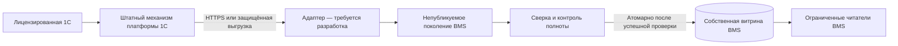

# Штатный обмен с 1С и внешними системами

## Статус реализации

**HTTP/OData-адаптер, файловый приёмник и полный издатель витрины пока
не реализованы.** Ниже описаны целевая архитектура, требования и порядок
приёмки для отдельной разработки. Не добавляйте вымышленные URL, JSON или
процедуры как якобы существующий API. Импорт факта, справочников и оплат
без нового проверенного адаптера не готов к эксплуатации.

В пакет входят [локальные обработчики](../integrations/README.md), серверные
читатели собственной витрины и проверки происхождения факта.

## Целевая архитектура

Это проектная схема, не перечень автоматически установленных компонентов.
SQL-подключения относятся к собственным БД BMS. Получение данных внешней
учётной системы проектируется через документированные механизмы платформы
с проверкой прав, лицензий и согласованного состава выгрузки.

## Механизмы со стороны 1С

- HTTP-сервис с явно ограниченным контрактом данных.
- Стандартный REST/OData-интерфейс с минимальным опубликованным набором объектов.
- Web-сервис платформы.
- Регламентная файловая выгрузка JSON/XML, сформированная средствами платформы.

Это варианты для выбора при внедрении, а не четыре готовых адаптера пакета.
При выборе проверяются возможности версии платформы, конфигурации, права,
серверная нагрузка и условия лицензирования. OData документирован фирмой 1С
как механизм интеграции сторонних систем: [REST-интерфейс 1С](https://v8.1c.ru/platforma/rest-interfeys/).
Юридические границы: [INTEGRATION_LICENSING](INTEGRATION_LICENSING.md).

## Что согласовать до разработки

| Контракт | Что зафиксировать |
| --- | --- |
| Источники | Организации, конфигурации, версии, владельцы данных и разрешённые механизмы |
| Объекты | Прикладные имена и устойчивые идентификаторы опубликованных объектов |
| Набор | Справочники, факт ДДС, оплаты, сторно и расшифровки; полнота каждого контура |
| Период | Дата отсечения, часовой пояс, границы включения и режим исправлений |
| Сопоставления | Источник → прикладной объект → идентификатор → карточка BMS |
| Деньги | Валюта, точность, сумма, курс и кратность, НДС, знак движения |
| Оплата | Устойчивая связь с заявкой, идентификатор события и связь сторно с оригиналом |
| Контроль | Количества строк и документов, суммы, хеши, поколение и версия контракта |
| Безопасность | HTTPS, аутентификация, полномочия, секреты, журнал и приватное хранение |

Конкретная JSON-схема ещё не утверждена и не является входом существующего
HTTP-метода BMS. Контракт приёмника, маппинг в текущие модели и публикацию
витрины нужно реализовать вместе. Логи не должны содержать пароли, токены
или полные выгрузки с персональными данными.

## Порядок внедрения

1. На отдельной тестовой установке согласовать механизм и лицензирование.
2. Реализовать выгрузку через платформу 1С и ограничить её права и состав.
3. Реализовать адаптер и полный профиль собственной витрины BMS: хранение,
   процедуру публикации и совместимые ограниченные процедуры чтения.
   Основной установщик BMS эту витрину не создаёт.
4. Сначала собирать данные в непубликуемое поколение. Для постраничной выгрузки
   проверить непротиворечивость данных и достижение конца всех страниц.
5. Сверить документы, строки, суммы, валюты, даты и утверждённые исключения
   с тем же первичным источником и тем же периодом. Разницу не балансировать.
6. Блокировать неполные поколения, неизвестные статьи, неоднозначные связи,
   дубли событий и нарушения точности. Отказ не публиковать как нулевой факт.
7. Опубликовать согласованное поколение атомарно. Сохранить контрольные итоги
   и ссылку на источник; повтор той же выгрузки не создаёт новых движений.
8. Перечитать API и отчёты BMS; проверить частичную и полную оплату, сторно,
   повтор, валюты, переход года и отсутствие двойного учёта резерва / факта.
9. Принять новый контур и только затем поэтапно включать фоновые функции.

При ошибке сохраняется последний подтверждённый снимок с его реальной датой;
он не объявляется свежим. Недоступный источник не заменяется учебными данными.

## Оплаты и защищённые настройки

В начальном профиле `BudgetControlEnabled`, `ReconciliationEnabled` и
`ReschedulingEnabled` выключены. Код запрещает сверку / переносы без
обязательного бюджетного контроля. Проверки Windows-службы, служебного
пользователя, SQL-полномочий и доверенных контрактов не снимаются ради запуска.
Новый адаптер должен пройти эти границы, а не обойти их.

Оплата не подтверждается клиентским JSON, скриншотом платёжки или прямым
INSERT в таблицы заявки. Существующий общий оркестратор не является готовым
универсальным HTTP API. Контроль частичной оплаты, полной оплаты, сторно,
переплаты и идемпотентности обязателен при реализации нового приёмника.

## Почта и собственная SQL БД

Недельный обработчик читает данные BMS. Его сборка
не означает готовность SMTP или разрешение на рассылку. Сначала проверить
полноту исходного факта, права адресатов, очередь без отправки, TLS, ACL,
журнал попыток и неизвестный исход доставки. Рабочие получатели и секреты
хранятся вне Git.

## Протокол приёмки обмена

Зафиксировать версии, механизм платформы, период, дату отсечения, источники,
количества документов / строк, суммы по валютам, исключения, неизвестные связи,
хеш выгрузки и поколение. Приложить сверку источника и результата, повтор
без дублей, отказ при обрыве страниц / подмене источника и результат полного
цикла оплаты. Одной компиляции или успешного HTTP 200 недостаточно.
