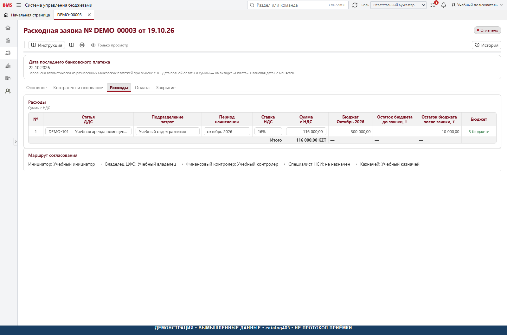
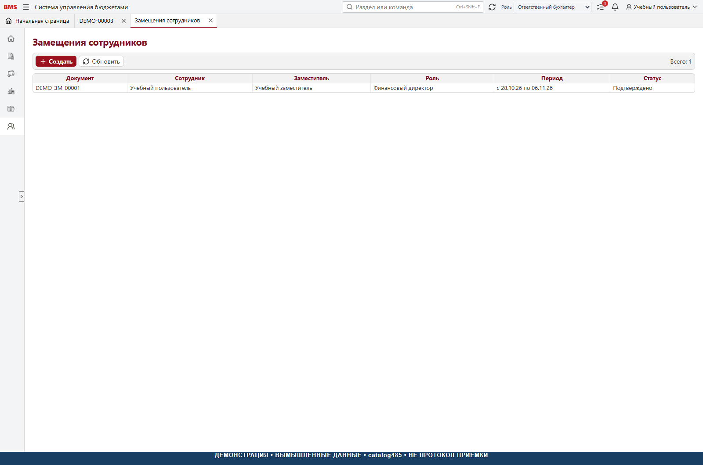

# Скриншоты и учебные данные

## Происхождение

Снимки сделаны с настоящей production-сборки React-интерфейса BMS 1.0
на основе catalog485, с нейтрально-серой темой публичной редакции,
запущенной в отдельном локальном браузерном окружении. Серверные ответы
заменены синтетическими фикстурами только в закрытом инструменте подготовки
документации. Запросы к внешним хостам блокировались; браузер работал
только с локальным окружением иллюстраций.

В публичный пакет включены PNG и описание, но **не** транспорт подмены API,
синтетическая БД или отключение защиты приложения. Основной frontend
остаётся без рабочего demo-backdoor. Скриншоты — иллюстрации интерфейса,
а не свидетельство выполнения серверной транзакции или прохождения приёмки.
Дата обновления снимков — 29 октября 2026 года. Учебные даты внутри примера
сохранены для сопоставимости. Разрешение — 1 600 × 1 060 пикселей
для обычного экрана; фактическая высота может увеличиваться для полной страницы.

Каждый снимок содержит полосу «ДЕМОНСТРАЦИЯ · ВЫМЫШЛЕННЫЕ ДАННЫЕ · catalog485 ·
НЕ ПРОТОКОЛ ПРИЁМКИ». Она добавлена в демонстрационный DOM до захвата, а
не закрашивает реальные реквизиты. Реальные данные вообще не загружались.
Фоны верхней и боковой панелей проверяются по вычисленным CSS-цветам
на каждом снимке. Семантические индикаторы статусов и предупреждений сохранены.

## Состав учебного примера

Организация — «Учебная компания „Северный пример“», подразделение —
«Учебный отдел развития», поставщик — «Учебный поставщик „Образец“».
Сотрудники подписаны «Учебный пользователь / инициатор / контролёр /
владелец / заместитель», номера имеют префикс DEMO. Идентификаторы —
синтетические, не копии идентификаторов компании. Реальные БИН, адреса,
телефоны, email, Windows-SID и банковские реквизиты не использованы.

Учебный бюджет квартала: 900 000 ₸, по 300 000 ₸ на октябрь–декабрь.
Оплаченная незакрытая DEMO-00003: 116 000 ₸ с НДС, из них НДС 16 000 ₸
и без НДС 100 000 ₸. Полная учебная оплата — 22 октября, возраст на
28 октября — 6 календарных дней. Акрул: первоначально 116 000, закрыто 0,
остаток 116 000 ₸. Это не реальный бухгалтерский пример и не рекомендация
ставки для конкретного договора.

Другие документы показывают отдельные состояния: согласование 116 000 ₸,
закрытая заявка 58 000 ₸ и черновик. Для месячного контрольного примера:
300 000 − 116 000 резерв − 174 000 оплачено = 10 000 ₸. Не складывайте
исходную заявку, её карточку, платёж и акрул как четыре независимых расхода.

Формы создания показывают в том числе незаполненные поля; их готовность
к подаче не заявляется. Настройки задач / полномочий в демонстрационном
сеансе предназначены для иллюстрации, права новой установки проверяются
отдельно. Из скриншотов нельзя выводить полномочие роли на любую видимую кнопку.

## Перечень

| № | Снимок | Что показано |
| --- | --- | --- |
| 01 | [Рабочая область](images/01-workspace.png) | Навигация, роль, задачи |
| 02 | [Список заявок](images/02-requests.png) | Согласование, оплата и закрытое состояние |
| 03 | [Фильтры](images/03-request-filters.png) | Организация, ЦФО, контрагент, инициатор, статус |
| 04 | [Мои задачи](images/04-tasks.png) | Учебное задание согласующему |
| 05 | [Экземпляры бюджетов](images/05-budget-list.png) | Утверждённый квартальный план |
| 06 | [Организации](images/06-organizations.png) | Нейтральная карточка справочника |
| 07 | [Статьи затрат](images/07-expense-items.png) | Отдельный справочник затрат |
| 08 | [Основное черновика](images/08-request-main.png) | Организация, ЦФО, дата, валюта и назначение |
| 09 | [Версии компании](images/09-versions.png) | Действующий состав бюджета |
| 10 | [Должники](images/10-debtors.png) | Текущая оплаченная незакрытая заявка |
| 11 | [Помощь](images/11-help.png) | Дерево вопросов; старые подписи коротких PDF не исправлялись |
| 12 | [Активные акрулы](images/12-active-accruals.png) | Ненулевой остаток и возраст |
| 13 | [Подразделения](images/13-departments.png) | Учебное подразделение затрат |
| 14 | [Контрагент и основание](images/14-counterparty.png) | Структура ввода основания |
| 15 | [Расходы черновика](images/15-expenses.png) | Структура строк и подсказки до заполнения |
| 16 | [Закрытие](images/16-closing.png) | Частичное и полное закрытие, дата документов, причина |
| 17 | [Оплаченная заявка](images/17-paid-request.png) | Карточка только для чтения |
| 18 | [Расходы оплаченной заявки](images/18-paid-expenses.png) | Сумма, НДС, период, подразделение, маршрут |
| 19 | [Оплата](images/19-payment.png) | Подтверждённая учебная сумма и остаток |
| 20 | [Замещения](images/20-substitutions.png) | Основной сотрудник, заместитель, срок и статус |

## Ключевые иллюстрации

### Расходы оплаченной заявки

### Оплата

### Закрытие

### Замещение

## Что эти снимки не покрывают

Фактическую Windows-аутентификацию, SQL-транзакции, конкурентное
резервирование, реальную смену статуса, работу антивируса, импорт из 1С,
доставку почты и восстановление резервной копии. Для них требуется
[отдельная приёмка](ACCEPTANCE.md). Хеши PNG находятся в
[манифесте изображений](images/manifest.json).
