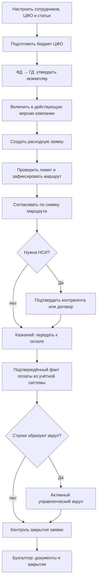
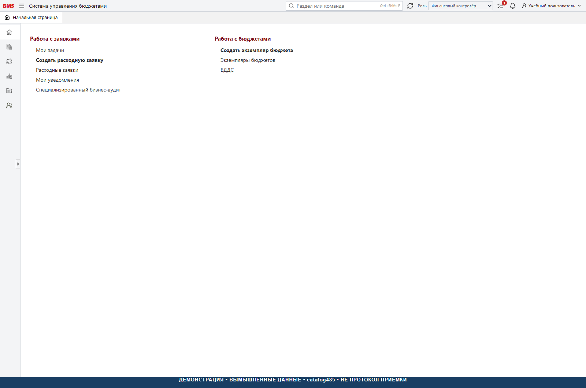

# Полное руководство по бизнес-процессам BMS

Версия 1.0. Язык: русский. Назначение: обучение пользователей и
согласование порядка работы при новом внедрении. Все примеры учебные.

Техническая основа версии 1.0 — зафиксированный срез catalog485.

## 1. Что именно автоматизирует BMS

BMS связывает планирование денежных средств по ЦФО, согласование расходных
заявок, контроль лимита, казначейскую очередь, управленческие начисления и
контроль закрывающих документов. Бухгалтерский учёт остаётся в отдельной
учётной системе. BMS не подменяет банк, регламентированный учёт или юридическую
проверку документа. Наличие кнопки или формы не означает наличие проведения:
границы вспомогательных экранов описаны в [реестре функций](FEATURES_AND_LIMITATIONS.md).

## 2. Сквозной порядок работы

Схема описывает основной сценарий. Возврат, отклонение, отмена, частичная
оплата, специальные операции и повторное открытие разобраны в соответствующих
разделах. Шаг «факт оплаты» зависит от настроенного и проверенного обмена,
которого в пустой установке ещё нет.

## 3. До начала работы

1. Получите адрес HTTPS-портала у администратора своей установки.
2. Войдите доменной учётной записью Windows/AD. Не отправляйте пароль в чат,
   письмо, журнал ошибки или скриншот.
3. Проверьте своё имя и выбранную роль вверху справа.
4. Убедитесь, что назначены нужные организация и ЦФО.
5. Проверьте активность статей и наличие требуемых справочников.
6. Для валютной заявки проверьте курс, дату и кратность.
7. Перед подачей убедитесь, что бюджет не только согласован, но и включён
   в действующую версию компании.

## 4. Правила работы с интерфейсом

Меню слева открывает функциональные разделы. Поле «Раздел или команда» ищет
навигацию, а не строки всех документов. Горячая клавиша — Ctrl+Shift+F.
Документы открываются во вкладках. Перед обновлением браузера, выходом,
сменой роли или закрытием вкладки сохраните доступный черновик.

Роль выбирает режим уже выданных прав. Нельзя получить право согласовать,
просто выбрав текст роли или открыв прямую ссылку. Сервер повторно проверяет
сотрудника, роль, область доступа, состояние и версию документа.

F11 переключает полноэкранный режим, Ctrl+0 возвращает масштаб 100%.
При широкой таблице используйте горизонтальную прокрутку. Не считайте скрытые
колонки отсутствующими данными. Перед экспортом проверьте фильтры и количество
строк; выгрузка не должна восприниматься как список только текущей страницы.

## 5. Ролевые маршруты чтения

| Роль | Основная последовательность |
| --- | --- |
| Инициатор ЦФО | [Доступ](business/01-roles-and-access.md) → [заявки](business/04-expense-requests.md) → [замещения и задачи](business/08-substitutions-and-notifications.md) |
| Владелец бюджета / руководитель подразделения | [Бюджет](business/03-budgeting.md) → [решения по заявкам](business/04-expense-requests.md) → [исполнение](business/07-reports.md) |
| Финансовый контролёр | [Аналитики](business/02-master-data.md) → [проверка заявки](business/04-expense-requests.md) → [акрулы](business/06-accruals-and-closing.md) |
| Финансовый директор | [Версии компании](business/03-budgeting.md) → [дефицит и маршруты](business/04-expense-requests.md) → [отчёты](business/07-reports.md) |
| Генеральный директор | [Утверждение бюджетов](business/03-budgeting.md) → [согласование дефицита](business/04-expense-requests.md) |
| Казначей | [Очередь и оплата](business/05-treasury-and-payments.md) → [календарь](business/07-reports.md) |
| Ответственный бухгалтер / главный бухгалтер | [Первичка и закрытие](business/06-accruals-and-closing.md) → [должники](business/07-reports.md) |
| Специалист НСИ | [Новые контрагент и договор](business/04-expense-requests.md) |
| Администратор | [Установка](INSTALLATION.md) → [эксплуатация](OPERATIONS.md) → [приёмка](ACCEPTANCE.md) |

Бухгалтер и ответственный бухгалтер — разные технические роли этого среза.
Общий доступ на чтение не означает право закрытия. Технический администратор
не получает автоматически полномочия финансового директора или бухгалтера.

## 6. Ежедневный контроль

Перед началом дня: открыть «Мои задачи», уведомления о возврате, очереди
оплат и незакрытые оплаченные заявки. Проверить свежесть источников, если
решение зависит от факта. В течение дня: сохранять черновики, обрабатывать
решения с понятной причиной, не дублировать документы при сбое связи.
В конце дня: проверить неподтверждённые операции, незавершённые загрузки
вложений, новые оплаты и документы, требующие закрытия.

Ежемесячно: сверить действующую версию бюджета, план/факт, активные акрулы
по календарным месяцам и перечень должников. Наличие месячного отчёта само
по себе не вводит запрет проводок или процедуру закрытия периода: это отдельная
возможность, не подтверждённая данным руководством.

## 7. Три обязательных различия

- **Утверждённый экземпляр ≠ действующий бюджет компании.** Для лимита важен
  состав действующей версии.
- **Плановая дата / очередь ≠ подтверждённая оплата.** Факт должен прийти через
  проверенный серверный механизм и быть сопоставлен с заявкой.
- **Закрытие BMS ≠ создание бухгалтерского документа.** Оно подтверждает
  управленческое закрытие и меняет остаток акрула, но не проводит документ в 1С.

## 8. Если поведение отличается

Остановите повторные действия, запишите номер документа, время, выбранную
роль и текст ошибки. Не меняйте суммы для обхода проверки. Сравните с
[устранением проблем](TROUBLESHOOTING.md). Если различаются это руководство,
встроенная короткая помощь и старое ТЗ, используйте
[реестр расхождений](FEATURES_AND_LIMITATIONS.md) и проверку фактических
прав на сервере. Изменение бизнес-правила требует отдельного решения,
а не только правки текста инструкции.

Реализация: [навигация](../frontend/src/navigation.ts),
[помощь интерфейса](../frontend/src/pages/helpContent.ts),
[сеанс и доступ](../frontend/src/api/sessionPublicResponse.ts).
