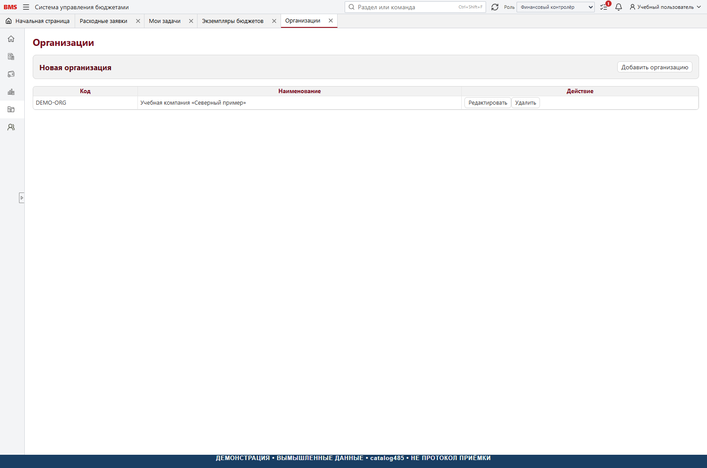
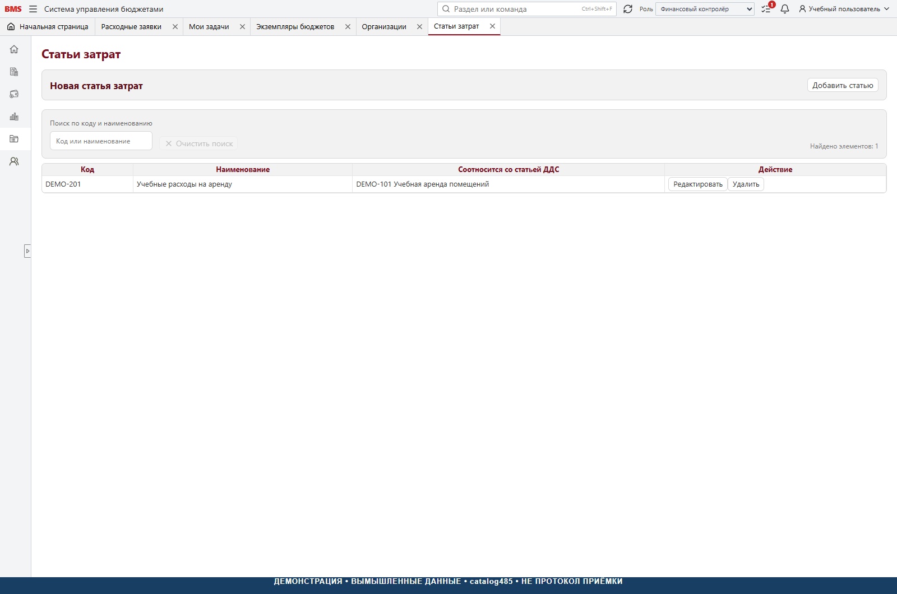

# 2. Справочники и аналитики

[К руководству](../USER_GUIDE.md)

## Порядок подготовки

Сначала организации и подразделения, затем статьи затрат и статьи ДДС,
связи статей с ЦФО, сотрудники и назначения, матрица согласования, валюты
и курсы, контрагенты и договоры. Иначе пользователь может заполнить форму,
но не пройти серверную проверку готовности.

## Организация

Организация в заявке определяет юридический контур и область договора.
Сравнивайте наименование и код, а не похожие подписи. Выбирайте собственную
организацию, от имени которой должен проходить платёж. Справочник пустой
у новой установки: создавать записи старой компании или вымышленные UUID
для обхода интеграции нельзя.

## Подразделение, ЦФО и подразделение затрат

ЦФО отвечает за бюджет. Подразделение затрат показывает, куда отнести
управленческий расход. Они могут различаться по смыслу. Пользователь выбирает
подразделение затрат из доступного справочного представления, а не вводит
свободный текст. В коде есть отдельные публичные представления
`cost-centers`, `accrual-cost-centers`, `cost-departments`: их согласованность
и происхождение необходимо проверить при адаптации НСИ новой установки.
Это не основание создавать несвязанный второй набор подразделений вручную.

## Статья ДДС

Статья ДДС определяет денежное направление, группу, вид деятельности,
ЦФО и параметры участия в акрулах. Группа не должна подменять конечную
статью строки. Используйте стабильный идентификатор; переименование
должно менять подпись, а не создавать другую экономическую сущность.

Порядок настройки статьи:

1. Открыть «Справочники → Статьи движения денежных средств».
2. Найти по коду и названию; проверить, что редактируется не группа.
3. Включить доступный режим редактирования.
4. Указать группу, вид деятельности, направление и ЦФО.
5. Если статья образует управленческий акрул, включить «Акрул» и выбрать
   отдельную статью затрат.
6. Сохранить строку галочкой и дождаться подтверждения.
7. Перечитать карточку и проверить использование статьи в нужном ЦФО.

Признак акрула без статьи затрат не является заполненной настройкой.
Выключение признака очищает связь со статьёй затрат. Изменение текущей
карточки не следует трактовать как автоматическое изменение всех ранее
зафиксированных снимков заявок.

## Статья затрат

Это отдельный справочник, не альтернативное название статьи ДДС. Одна
показывает поток денег, другая — экономическую классификацию начисления.
Справочник может показывать связанные статьи ДДС. Проверяйте правильность
связи до подачи заявки, а не исправляйте её удалением используемых записей.

## Контрагент и договор

Договор выбирается в контексте конкретных организации и контрагента.
Если список пуст, сначала проверьте эти два поля. Нельзя использовать
договор похожего поставщика для ускорения подачи. Для нового контрагента
или договора предусмотрены отдельные признаки, поля и этап НСИ.

У нового контрагента различаются резидент РК и нерезидент. Заполняйте
БИН/ИИН либо иностранные регистрационные реквизиты согласно выбранному
варианту. Отсутствие документа или номера допускается только там, где
форма предлагает явное исключение с пояснением. Это не универсальная
возможность пропускать обязательные поля.

## Валюты и курсы

Проверьте буквенный код, числовой код при необходимости, дату курса, курс
и кратность. Наличие USD в справочнике не гарантирует наличие пригодного
курса на дату заявки. Автозагрузка Национального банка в пакете выключена.
Ручная подстановка случайного курса ради сохранения не допускается.

## Что проверить после изменения

Поиск по коду и названию; фильтр ЦФО; раскрытие иерархии; следующую страницу;
сохранение и повторное чтение; запрет изменения неуполномоченным лицом;
доступность правильной статьи в новой заявке и бюджете. Перед удалением
сначала проверьте использование. Удалять и создавать заново для обычного
переименования не требуется.

Реализация: [публичные справочники](../../frontend/src/api/referenceData.ts),
[настройки акрула у статьи](../../frontend/src/api/cashFlowAccrualSettings.ts),
[серверная валидация](../../backend/src/Bms.Application/ReferenceData/CashFlowAccrualSettingsService.Validation.cs).
