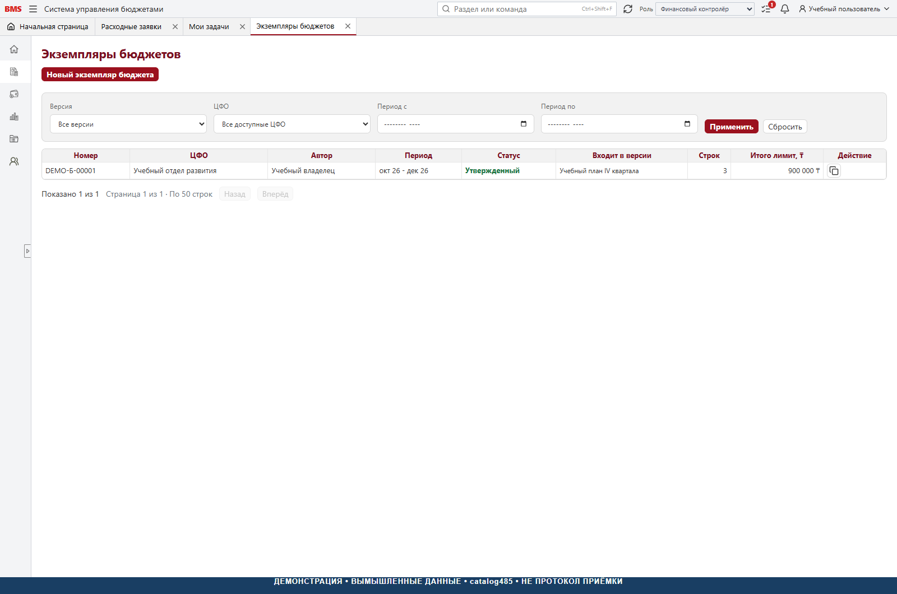
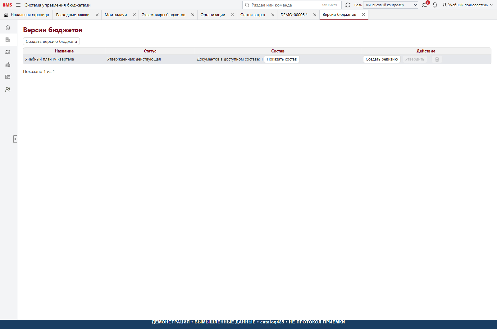

# 3. Бюджетирование

[К руководству](../USER_GUIDE.md)

## Три разных объекта

| Объект | Назначение | Чего сам по себе не делает |
| --- | --- | --- |
| Экземпляр бюджета ЦФО | Статьи, календарные месяцы, направления, суммы | Не становится действующим лимитом до включения в нужную версию |
| Согласование экземпляра | Зафиксированные решения ФД и ГД | Не подменяет состав версии компании |
| Версия бюджета компании | Объединяет выбранные экземпляры | Не утверждает автоматически черновики |

## Создание экземпляра

**Исполнитель:** владелец / инициатор в своей области либо финансовая роль
с соответствующим правом. **Вход:** настроенные ЦФО, статьи и нумерация.

1. Открыть «Бюджетирование → Экземпляры бюджетов» и создать экземпляр
   либо использовать «Экземпляр бюджета» в группе «Создать».
2. Проверить ЦФО, период начала и окончания. Месяцы строк должны входить
   в период заголовка.
3. Добавить доступные статьи. Для каждой указать месяц, направление и сумму.
4. При необходимости добавить понятный комментарий к строке.
5. Сверить поступления, выплаты и чистый поток; не сводить расхождения
   искусственной балансировочной строкой.
6. Сохранить черновик, перечитать его и проверить номер и строки.

При копировании существующего экземпляра создаётся новый документ, а не
редактируется исходный. Перед сохранением копии перепроверьте все месяцы,
аналитики и суммы: копия не является автоматически утверждённой версией.

## Табличный вид

Табличный вид агрегирует строки по статьям и месяцам. Поступления положительные,
выплаты отрицательные. В подробном виде направления и комментарии видны отдельно.
Если в одной ячейке есть оба направления, ручное изменение чистой суммы
может заменить их одной строкой. Это влияет на расходный лимит: перед
подтверждением изучите предупреждение и проверьте подробный вид.

Не путайте знак отображения денежного потока с невалидной отрицательной
суммой строки. Следуйте выбранному направлению и правилам формы.

## Копирование факта в план

Выберите диапазон месяцев и статьи → выполните «Скопировать факт» → сверяйте
результат → сохраните черновик. Это копирование уже загруженной серверной
копии факта, а не запуск обмена с 1С. Выбранные ячейки заменяются, не
увеличиваются на вторую такую же сумму. Подтверждённый нулевой факт обнуляет
выбранную сумму; отсутствие загрузки не равно нулю и должно блокировать
подмену. Остальные месяцы и статьи остаются неизменными.

В статической помощи остаются ссылки на 2026 год. Для другого года сначала
проверьте фактическую поддержку API и источника; не предполагайте перенос
годовых сумм автоматически.

## Подача и решения

1. Нажать «Подать на согласование». Интерфейс сохраняет текущий ввод и
   проверяет подтверждённую версию.
2. Дождаться статуса согласования и проверить маршрут.
3. Финансовый директор рассматривает документ; после него решение принимает
   генеральный директор независимо от суммы превышения.
4. При возврате изучить комментарий, исправить черновик, сверить итоги и
   подать заново. Сохраняется история предыдущих решений.
5. При отклонении не считать экземпляр утверждённым или действующим.

На этапе согласования строки заблокированы. Утверждённые лимиты не изменяют
простым редактированием. Применяйте копию / новый экземпляр либо предусмотренную
корректировку, а не изменение SQL вручную. Финансовый контролёр в коде имеет
специальную возможность остановки возвратом / отклонением на этапе ФД;
это **не** дополнительный обязательный этап обычного маршрута.

## Действующая версия компании

Откройте «Версии бюджетов». Проверьте название, состав, признаки публикации
и активности. Включите нужные утверждённые экземпляры, изучите пересечения
по ЦФО и месяцу, выполните разрешённую команду активации. Повторно откройте
версию и проверьте, что именно она действующая.

Из двух экземпляров одного ЦФО на пересекающийся период нельзя делать вывод
«лимиты всегда складываются». Интерфейс версии содержит информацию о
пересечениях и выбранном эффективном экземпляре. Решение должно проверяться
по фактическому составу и правилам эффективного бюджета.

После утверждения бюджета, созданного позже заявки, черновик заявки не
обязательно пересоздавать: при подаче сервер заново читает лимит. Но уже
зафиксированный маршрут поданной заявки сам не сокращается. Для обычного
перезапуска используют возврат и повторную подачу, а не скрытое удаление этапов.

## Корректировка и контроль

Для изменения утверждённого плана используйте «Корректировка экземпляра
бюджета», если команда доступна вашей роли. Проверьте основание, исходный
экземпляр, месяцы и статьи, итог изменения и маршрут. Наличие экрана не
разрешает изменять утверждённый бюджет в обход команд приложения. После решения проверьте состав
действующей версии и отчёт исполнения: согласованный документ и опубликованный
лимит — разные контрольные точки.

Удаление через список предусмотрено для допустимых черновиков и роли с
правом удаления; в короткой помощи это финансовый директор. Не удаляйте
документы для сокрытия неудачного согласования.

## Контроль результата

- Период заголовка включает все месяцы строк.
- Статьи соответствуют ЦФО и активны.
- Итоги проверены отдельно по направлениям, а не только по чистому потоку.
- Есть решения ФД и ГД; нет незавершённого возврата.
- Экземпляр включён в нужную действующую версию.
- Контроль заявки использует новый лимит, а не только изменившуюся подпись.

Реализация: [форма и список](../../frontend/src/pages/BudgetInstancesPage.tsx),
[матричный ввод](../../frontend/src/pages/budgetInstanceMatrix.ts),
[согласование](../../backend/src/Bms.Application/Budgeting/BudgetApprovalWorkflowService.cs),
[оценка и маршрут](../../backend/src/Bms.Domain/Budgeting/BudgetApprovalAssessment.cs),
[версии компании](../../frontend/src/api/companyBudgetVersions.ts).
