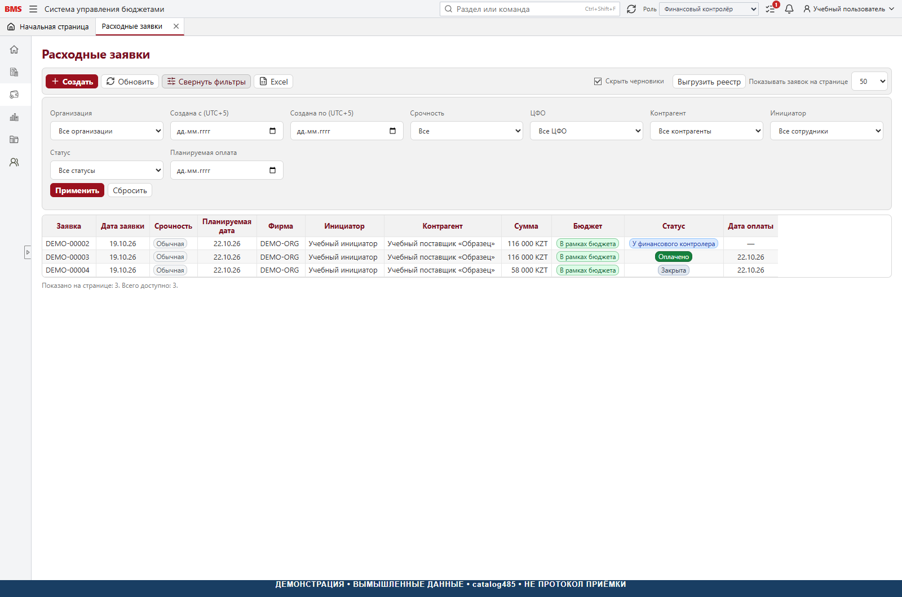
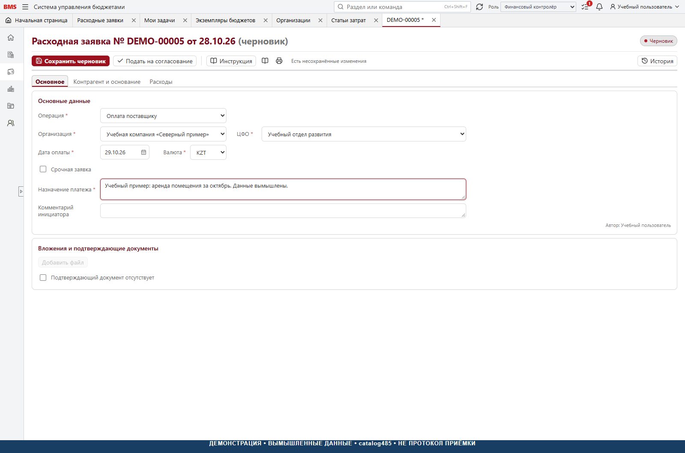
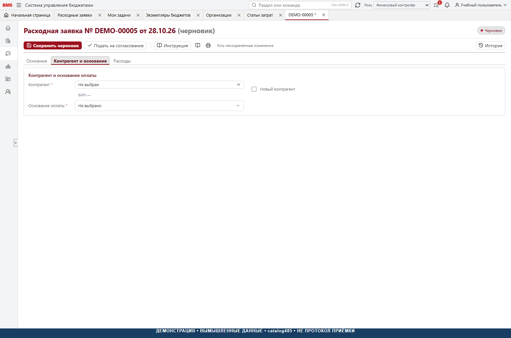
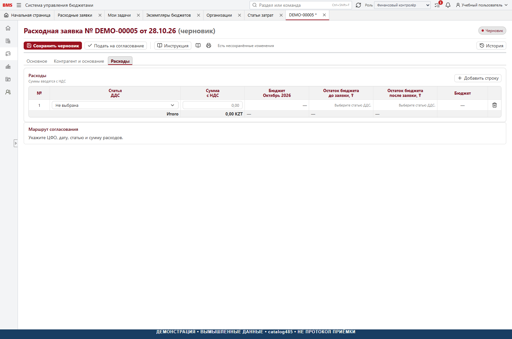
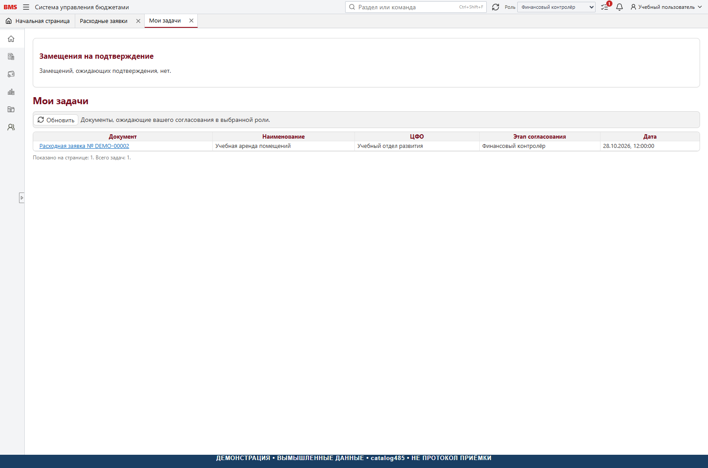

# 4. Расходные заявки

[К руководству](../USER_GUIDE.md)

## Цель и входные условия

Заявка фиксирует потребность в платеже, аналитику бюджета, основание, маршрут
решений и последующий жизненный цикл. До начала нужны доступный ЦФО,
организация, статьи, контрагент / вариант нового контрагента, основание,
дата оплаты и при валютном платеже пригодный курс.


## Поиск существующей заявки

Открыть «Казначейство → Расходные заявки». Проверить «Скрыть черновики»:
черновик может существовать, но не показываться при включённом флажке.
Раскрыть «Фильтры», проверить организацию, ЦФО, контрагента, инициатора,
статус, дату и срочность. Не создавать вторую заявку только потому, что
первая не видна под текущим отбором. При большом списке проверить пагинацию.



## Шаг 1. Создать документ

Нажать «Создать» в списке или «Расходная заявка» в разделе «Создать».
Номер определяется автоматически по настроенной нумерации ЦФО; ручная
подстановка номера не заменяет сохранение. Номер может быть предварительно
зарезервирован, а не означать, что документ уже записан на сервере.

## Шаг 2. Заполнить «Основное»



| Поле | Что проверить |
| --- | --- |
| Операция | Поставщик, налоги/социальные платежи, аванс, подотчёт или командировка — не взаимозаменяемые сценарии |
| Организация | Правильный юридический контур и доступ |
| ЦФО | Бюджетная ответственность, а не произвольное подразделение |
| Дата оплаты | Плановый день; определяет бюджетный месяц и казначейскую очередь |
| Валюта | Валюта обязательства; суммы тенгового контроля проверяются отдельно |
| Срочность | При включении заполнить обоснование; не означает автоматическое согласование |
| Назначение платежа | Понятное описание деловой цели и периода |
| Комментарий | Дополнительный контекст, не подмена основания и суммы |
| Вложения | Подтверждающие материалы или разрешённый вариант отсутствия с пояснением |

Не записывайте пароли, платёжные ключи и лишние персональные данные в комментарии.
Смена операции может очистить несовместимые поля: прочитайте подтверждение,
сначала сохраните нужный текст отдельно в разрешённом месте.

## Шаг 3. Контрагент и основание



**Существующий контрагент:** выбрать его из справочника, затем допустимый
договор в контексте организации. **Новый:** включить признак, заполнить имя
и регистрационные данные, резидентность и требуемые пояснения.

Варианты основания в контракте:

- `Contract` — договор; выбрать существующий либо заполнить новый.
- `InvoiceWithoutContract` — счёт без договора; заполнить номер и дату счёта.
- `PublicOffer` — публичная оферта; указать наименование и идентификатор.
- `OtherBasis` — другое основание; дать содержательное объяснение.

У нового договора заполнить номер / разрешённый признак его отсутствия,
дату, предмет и условия. Документ нового договора — отдельный вид вложения.
Отсутствие вложения или номера объясняется через предусмотренные поля, а
не произвольным пробелом. Возможность исключения проверяется на сервере.

## Шаг 4. Строки «Расходы»



Добавить строки; выбрать статью ДДС, сумму и доступные аналитики. Для
статьи с акрулом проверить подразделение затрат, период начисления,
статью затрат из настройки и НДС. Период начисления — календарный месяц,
который не обязан совпадать с датой оплаты. Для нескольких месяцев или
подразделений нужны отдельные строки / распределения предусмотренного
интерфейса, а не описание разбиения только в комментарии.

В коде ставок представлены `Vat16` и `WithoutVat`. Это поддержанные варианты
формы данного среза, **не утверждение о применимости ставки к каждой сделке**.
Выбор проверяет ответственный специалист своей организации.

Учебный расчёт: сумма с НДС 116 000 ₸, НДС 16,0% — 16 000 ₸,
сумма без НДС — 100 000 ₸. Для «Без НДС» вся сумма строки является суммой
без выделенного НДС. Не нужно второй раз прибавлять НДС к уже полной сумме.
Хранимые расчёты проверяются с точностью копеек, даже если таблица показывает целые.

## Шаг 5. Бюджетный контроль

Контроль группируется по бюджетным ключам; отображение строки и совокупный
результат могут различаться. Для каждой позиции применяется смысловая формула:

```text
Резерв после подачи = текущий резерв − собственная прежняя проекция + новая проекция
Доступно после подачи = лимит − резерв после подачи − подтверждённый расход
Положительный дефицит = сумма max(0, −доступно) по всем позициям
```

Положительный остаток одной позиции не гасит дефицит другой. Поступления
не увеличивают расходный лимит автоматически. Пример: позиция А даёт −30 000,
позиция Б +50 000. Дефицит маршрута — 30 000, а не ноль и не −20 000.

Собственный резерв не должен вычитаться дважды. Повтор той же команды не
должен создавать второе движение. При изменении возвращённой заявки сервер
пересчитывает требуемую проекцию с учётом уже существующей, а не прибавляет
всю сумму заново. Если снимок / лимит недоступен или противоречив, готовность
блокируется: неизвестный лимит не является нулём или разрешением превысить его.

## Шаг 6. Сохранить и подать

«Сохранить черновик» сохраняет ввод без запуска согласования. «Подать на
согласование» сохраняет необходимые изменения, перечитывает подтверждённое
состояние и выполняет проверку готовности. Следите за результатом команды.
Не закрывайте окно во время неизвестного результата и не создавайте копию
для обхода сетевого сбоя. Используйте повтор той же попытки, когда он предложен.

После подачи содержательное редактирование ограничено. Для исправления
используют возврат; отдельные изменения аналитик согласования разрешены
только специальным серверным контрактом и не означают свободное изменение суммы.

## Как строится маршрут

Для обычного автора, который не удовлетворил свой этап специальным правилом:

| Положительный дефицит | Финансовая цепочка |
| --- | --- |
| 0 ₸ | Финансовый контролёр |
| Больше 0 и до 100 000 ₸ включительно | ФК → ФД |
| Свыше 100 000 ₸ | ФК → ФД → ГД |

Перед этой цепочкой добавляется независимый владелец ЦФО, если автор не
является владельцем соответствующего ЦФО. Подача владельца удовлетворяет
его собственный этап. Граница «свыше» принципиальна: 100 000 не равно 100 001.

**Исключения catalog485:** для прямой подачи ФД его собственный этап ФД
не добавляется; аналогично для ГД и его этапа. Для автора-ФК предусмотрены
версии, где подача удовлетворяет его собственный этап ФК. Независимый владелец
и остальные требуемые финансовые этапы сохраняются согласно конкретной версии.
Не описывайте это как разрешение самосогласования: участники и исключения
проверяются отдельно, а отсутствие независимого исполнителя блокирует маршрут.
Для аванса зарплаты предусмотрен отдельный маршрут; общая таблица к нему
не применяется без проверки.

Точный маршрут хранится снимком с номером и версией определения. Действующим
считается снимок конкретной заявки, не только сегодняшние назначения в матрице.
Изменение матрицы не должно переписывать уже принятые решения задним числом.

## Решение согласующего

Открыть «Мои задачи» под нужной ролью → открыть документ → прочитать строки,
лимит, маршрут, вложения и историю → выполнить доступное решение.

- **Согласовать:** принять текущий этап; это не всегда окончательное утверждение.
- **Вернуть:** указать причину, отправить на исправление. Резерв сохраняется;
  при новой подаче запускается новый снимок маршрута с начала.
- **Отклонить:** завершить согласование отказом; резерв освобождается.
- **Отменить:** доступно только в разрешённых состоянии и роли, до фактической
  оплаты. После оплаты закрытие и бухгалтерская корректировка не подменяются отменой.



Причина должна отвечать на вопрос, что именно исправить или почему отказано.
«Не так» недостаточно для нормальной работы, хотя длина текста сама по себе
не гарантирует деловой смысл. Проверяйте сохранённый результат в истории.

## НСИ и передача казначею

Если финансовая цепочка закончена, но нужны новые контрагент или договор,
заявка попадает в «Ожидает НСИ». Специалист НСИ проверяет и связывает
реквизиты через доступную команду. Это не даёт права обойти финансовые этапы.
После выполнения условий заявка утверждена; в текущем маршруте казначей
отдельно выполняет передачу «К оплате». Финансовое согласование не означает
автоматическую отправку в банк.

## Вложения

Максимум одного файла — 25 × 1 024 × 1 024 = 26 214 400 байт. Пустой файл,
недопустимое имя и исполняемые расширения отклоняются. Базовый запрет включает
exe, com, bat, cmd, msi, ps1, vbs, js, jse, wsf, wsh, scr, pif, cpl, hta.
Дополнительно действуют хранение, сканер и проверка полномочий: допустимое
расширение не делает файл автоматически безопасным.

Подтверждающий документ, новый договор и дополнительный документ различаются.
Дополнительные материалы к поданной заявке требуют комментария и не являются
свободно удаляемой заменой истории. При копировании РЗ вложения нужно добавить
заново. Загрузка в черновик использует временную upload-сессию; сбой загрузки
нельзя трактовать как успешно прикреплённый документ.

## Состояния, которые пользователь должен различать

| Код | Подпись | Деловой смысл |
| --- | --- | --- |
| DRAFT | Черновик | Подготовка, ещё не подан |
| RETURNED | Возвращена | Исправление и новая подача |
| IN_APPROVAL | На согласовании | Есть текущий этап снимка |
| APPROVED | Утверждено | Финансовые условия выполнены; не факт оплаты |
| AWAITING_NSI | Ожидает НСИ | Требуется завершить реквизиты |
| TO_PAY | К оплате | Казначейская очередь |
| PARTIALLY_PAID | Оплачена частично | Есть не весь подтверждённый платёж |
| PAID | Оплачена | Есть полное подтверждение; может требовать первичку |
| CLOSED | Закрыта | Управленческое закрытие оформлено |
| REJECTED | Отклонена | Отрицательный исход согласования |
| CANCELLED | Отменена | Разрешённая отмена до оплаты |

Реализация: [форма](../../frontend/src/pages/ExpenseRequestFormPage.tsx),
[поля и типы](../../frontend/src/types.ts),
[контроль дефицита](../../backend/src/Bms.Domain/Budgeting/SubmissionBudgetPreflightEvaluator.cs),
[планирование этапов](../../backend/src/Bms.Domain/Workflow/ApprovalRoutePlanner.cs),
[исключения автора](../../backend/src/Bms.Domain/Workflow/ExpenseRequestWorkflowDefinition251.cs),
[проверка участников](../../backend/src/Bms.Application/ExpenseRequests/ExpenseInitiatorRouteResolver.cs),
[статусы](../../backend/src/Bms.Domain/ExpenseRequests/ExpenseRequestStatus.cs),
[ограничения файлов](../../backend/src/Bms.Domain/ExpenseRequests/ExpenseRequestAttachmentUploadPolicy.cs).
