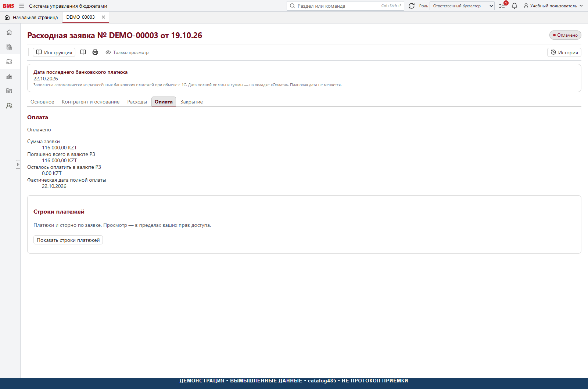

# 5. Казначейство и оплата

[К руководству](../USER_GUIDE.md)

## Очередь к оплате

Казначей выбирает свою активную роль, открывает утверждённую заявку,
проверяет дату, организацию, валюту, контрагента, основание и наличие
необходимых решений. Только разрешённая команда переводит документ
в «К оплате». Затем заявка проверяется в списке очереди / календаре.

Срочность — признак заявки, а не автоматический ранг платёжного поручения.
«Приоритеты оплаты» отбирают текущую очередь по дате, организации, ЦФО
и срочности; автоматические баллы и произвольная перестановка не реализованы
этим экраном. Нельзя обещать оплату только по факту попадания в список.

## Перенос даты

Используйте доступную казначейскую панель даты в карточке. Проверьте
старую и новую даты, изменение бюджетного месяца и результат проверки.
При включённом контроле источника перенос в другой месяц может быть
заблокирован настройкой `ReschedulingEnabled`. Не меняйте дату напрямую
в БД, не отключайте контроль для устранения такого сообщения.

После допустимого переноса заново проверьте бюджетный ключ, очередь,
маршрут и историю. Перенос через границу месяца не эквивалентен изменению
только визуальной даты: он может затрагивать лимит и резерв.

## Что считается оплатой

Оплату подтверждает проверенный серверный источник и его сопоставление
с заявкой. Нажатие «к оплате», установка плановой даты, добавление скана
платёжки или ввод номера документа в локальную форму не создают финансовый факт.
Для новой установки нужно разработать штатный адаптер и публикацию собственной витрины BMS,
затем принять сверку оплат. Готового нового адаптера нет; фоновые функции
выключены. См. [статус обмена](../INTEGRATION_GUIDE.md).

Проверьте:

1. Факт загружен полным согласованным поколением.
2. Источник, организация, контрагент, валюта и связь с заявкой определены.
3. Платёж не применён дважды; сторно связано с исходным событием.
4. Частичная сумма дала частичную оплату, а не преждевременное закрытие.
5. Полная оплата дала подтверждённую дату и правильное состояние.
6. Остаток резерва и отчёты не учитывают один расход дважды.

В репозитории есть общий `ConfirmedPaymentApplicationOrchestrator`, который
помечен как не подключённый самостоятельный путь. Его наличие не означает
наличие универсального публичного API для ручной проводки платежа.
Читатели уже опубликованных оплат сохранены в инфраструктурных сервисах.
Это не загрузчик из 1С; без нового контура получения и публикации факта
полный цикл автоматической оплаты на новой установке не готов.

## Просмотр платежей

«Безналичные платежи» читает платежи выбранной заявки с серверной проверкой
прав. Это не глобальная банковская выписка. В карточке различайте сумму
обязательства, подтверждённую оплату, остаток, валюту и тенговый эквивалент.
При неизвестной сумме в тенге используйте признак неполноты, не ноль.

Переплата, дефицит переплаты и ручные корректировки — отдельные объекты
с собственными основаниями и разрешениями. Не списывайте разницу произвольной
балансировочной строкой и не меняйте исходный платёж для визуального сведения.

## Что не является проведением

Формы подготовки «Сверки взаиморасчётов», «Взаимозачёты задолженности»,
«Списания задолженностей», «Поступление безналичных ДС» и «Списание
безналичных ДС» в catalog485 не подключены к полноценным серверным
командам соответствующих операций. Их локальный ввод не меняет банк,
взаиморасчёты, статус, резерв или факт. Не использовать их как подтверждение
юридической или бухгалтерской операции.

## Если оплату нужно исправить

После подтверждённой оплаты нельзя отменять заявку как неоплаченную.
Ошибочный источник исправляется проверенным механизмом исходной системы
и согласованной обработкой сторно / повторной загрузки. Изменение аналитики
в заявке не означает изменение фактической выписки. Закрытие первички
оформляется отдельно ответственным бухгалтером.

При расхождении зафиксируйте сумму, валюту, заявку, источник, дату и
поколение обмена; остановите повторную публикацию до выяснения причины.

Реализация: [границы экранов](../../frontend/src/financeWorkspaces.ts),
[казначейская дата](../../backend/src/Bms.Infrastructure/Persistence/TreasuryPaymentDateService.cs),
[настройки оплат](../../backend/src/Bms.Infrastructure/Persistence/AccountingPaymentSettings.cs),
[фоновая сверка](../../backend/src/Bms.Api/Workers/AccountingPaymentWorker.cs),
[граница общего оркестратора](../../backend/src/Bms.Application/Payments/ConfirmedPaymentApplicationOrchestrator.cs).
