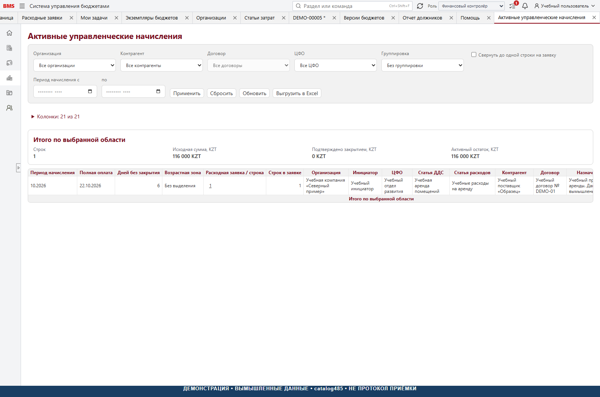
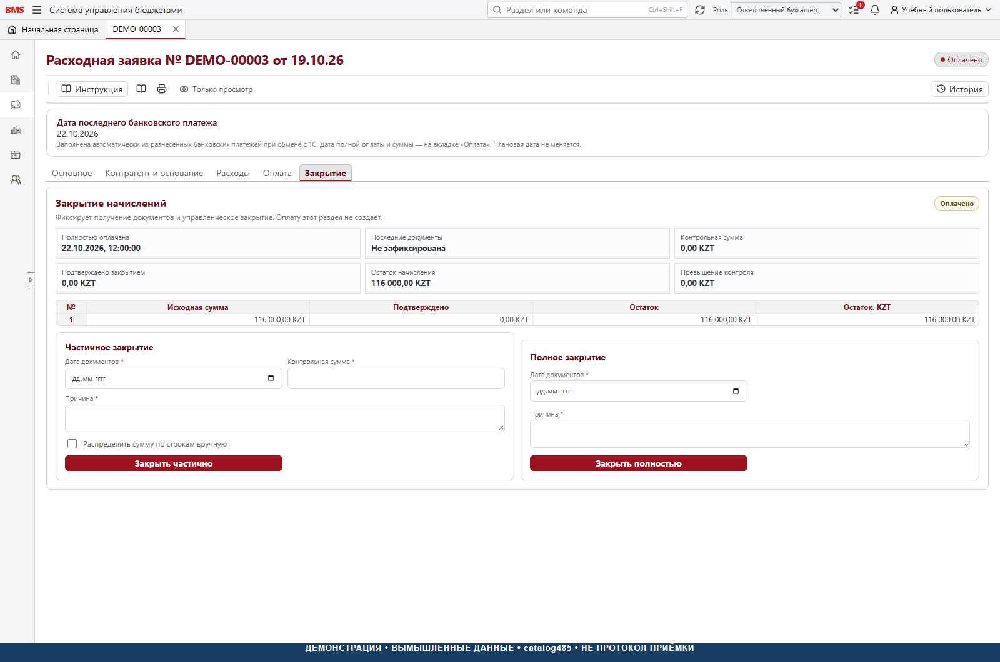

# 6. Акрулы, первичка и закрытие

[К руководству](../USER_GUIDE.md)

## Экономический смысл и граница

Акрул BMS — временная управленческая запись, связанная с оплаченной
заявкой и ещё не закрытой первичкой. Это не бухгалтерская проводка и
не автоматическая запись в 1С. Для товара, постоплаты с существующим
начислением и других нерасходных платежей не нужно механически включать
акрул: решение зависит от настроенной статьи и бизнес-содержания.

**Изменение относительно раннего обсуждения:** catalog485 использует
признак «Акрул» и статью затрат у статьи ДДС, снимки строк и аналитики
согласования. Нельзя документировать старое требование об отдельной
универсальной вкладке «Accruals» и чекбоксе ФК как точное описание этой формы.
В заявке соответствующие поля находятся в строках «Расходы» и разрешённых
настройках аналитики. Это отмечено также в [реестре расхождений](../FEATURES_AND_LIMITATIONS.md).

## Подготовка аналитики

ФК проверяет статью затрат, подразделение затрат, календарный месяц,
сумму и НДС. Для нескольких периодов / подразделений / статей нужны
отдельные строки или поддержанное распределение. Период в данных
представлен первым числом месяца, но означает весь календарный месяц.
Подразделение затрат может отличаться от бюджетного ЦФО.

Не меняйте общий справочник ради разовой переклассификации оплаченной
заявки без оценки влияния. Где доступен редактор аналитики, используйте
его с причиной и проверкой результата. Возможность редактирования
определяется сервером; обычный «карандаш» не даёт права менять сумму,
историю или подтверждённый платёж.

## Возникновение и остаток акрула

После полного подтверждения оплаты создаётся / фиксируется цикл начисления
по подходящим строкам. Исторические суммы и KZT берутся из снимка, а
не пересчитываются произвольно по сегодняшнему курсу. Проверить запись
можно в «Управленческий учёт → Активные управленческие начисления».



Проверка каждой строки:

```text
Первоначально = подтверждено закрыто + осталось
Первоначально KZT = подтверждено закрыто KZT + осталось KZT
```

История не удаляется при закрытии. Активный остаток уменьшается;
при полном закрытии он больше не должен выглядеть активным начислением.
Выражение «удалить акрул» в бытовом обсуждении не означает физическое
удаление аудита или всех прежних записей SQL.

## Кто закрывает

В catalog485 команды закрытия и повторного открытия требуют роли
`RESPONSIBLE_ACCOUNTANT` или `CHIEF_ACCOUNTANT`, активного сотрудника
и разрешённой организации. `ACCOUNTANT`, ФК, ФД и системный администратор
не получают это право автоматически. Если по правилам внедрения закрывать
должны другие роли, это отдельное изменение продукта с приёмкой.

## Полное закрытие



**Условие:** заявка полностью оплачена и находится в `PAID`, подтверждение
оплаты доступно. **Результат:** `CLOSED`, заполнена дата предоставления
документов, закрыт остаток начисления, сохранён аудит.

1. Открыть заявку в бухгалтерской роли.
2. Сверить организацию, контрагента, сумму, валюту и факт полной оплаты.
3. Проверить фактически предоставленные закрывающие документы.
4. На вкладке «Закрытие» указать дату предоставления документов.
5. Указать причину / пояснение, требуемое командой.
6. Выполнить полное закрытие и дождаться подтверждения.
7. Перечитать карточку, историю и отчёт активных начислений.

Дата предоставления документов — отдельное деловое поле, не дата клика,
не дата оплаты и не бухгалтерский период. Не заменяйте её вымышленной датой
ради закрытия. Сохраняется также техническое время операции.

## Частичное закрытие

Этот срез поддерживает частичное закрытие, хотя раннее пожелание было
«не усложнять, только кнопка». Вводится контрольная сумма документов;
сервис распределяет её по текущим остаткам подходящих строк пропорционально.
Есть возможность точного ручного распределения через контракт, если
соответствующий интерфейс доступен.

Правила распределения:

- Распределяется не больше текущего активного остатка.
- Суммы округляются до двух знаков; остаток округления относится на последнюю
  положительную строку по установленному порядку.
- Ручное распределение должно потреблять точную распределяемую сумму,
  не превышать остатки и не дублировать строки.
- KZT следует исходному снимку, не текущему валютному курсу.
- Излишек контрольной суммы фиксируется как контрольный факт, а не
  создаёт новый расход или отрицательный остаток.

Пример: активные остатки двух строк — 60 000 и 40 000 ₸; документы на
25 000 ₸ распределяются как 15 000 и 10 000 ₸. Остатки — 45 000 и 30 000 ₸.
Итого 100 000 = 25 000 + 75 000. Этот пример отдельный от скриншотного
сценария 116 000 ₸. Если частичное закрытие потребило весь акрул, не
предполагайте без проверки, что статус автоматически стал `CLOSED`:
полное закрытие — отдельная команда.

## Повторное открытие

При ошибочном полном закрытии уполномоченный бухгалтер открывает
`CLOSED`-заявку и выполняет «Открыть повторно» с причиной. Сервис
проверяет прежнее полное подтверждение оплаты, создаёт новый цикл
при наличии подходящих строк и сбрасывает текущий результат закрытия
по доменным правилам. Старые действия не стираются.

После команды нужно проверить статус, дату документов, новый остаток,
цикл и отчёт. Повторное открытие не означает второй платёж и не запускает
согласование исходной потребности с нуля. Повтор той же команды не
должен создавать ещё один цикл.

## Контроль ошибок

Если полная оплата не доказана, источник недоступен, версия устарела
или строки противоречат снимку, команда должна остановиться. Нельзя
закрывать через ручную смену `status` в SQL. При неизвестном результате
повторить прежнюю попытку, проверить историю и только затем принимать
следующее решение.

Реализация: [права закрытия](../../backend/src/Bms.Application/ExpenseRequests/ExpenseRequestClosingService.Read.cs),
[команды и транзакция](../../backend/src/Bms.Application/ExpenseRequests/ExpenseRequestClosingService.Execution.cs),
[распределение](../../backend/src/Bms.Domain/ExpenseRequests/AccrualClosingAllocationPlanner.cs),
[редактор аналитик](../../backend/src/Bms.Application/ExpenseRequests/ExpenseRequestWorkflowService.ApprovalDetails.cs),
[настройка статьи](../../frontend/src/api/cashFlowAccrualSettings.ts),
[панель закрытия](../../frontend/src/components/expense-request-form/ExpenseRequestClosingPanel.tsx).
