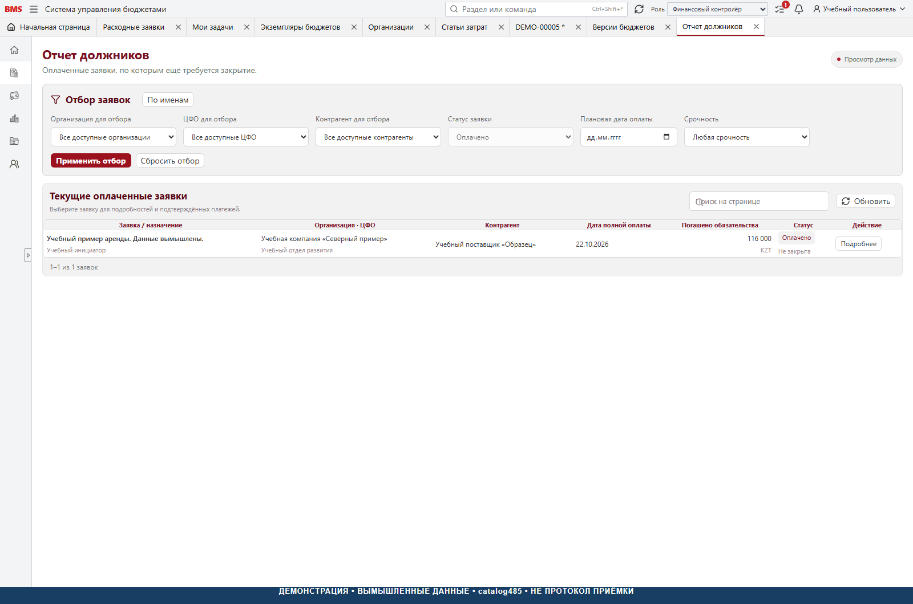

# 7. Отчёты и контроль показателей

[К руководству](../USER_GUIDE.md)

## Общий порядок

Выбрать роль и область → установить период и фильтры → обновить → проверить
свежесть / полноту → сверить итог с источником → открыть детализацию →
при необходимости выгрузить. Записать фильтры вместе с выгрузкой, иначе
сравнение двух разных отборов может выглядеть ошибкой суммы.

Ноль означает подтверждённое числовое значение. Пусто / «—» может означать
недоступный факт или нерассчитываемую величину. Не заменяйте отсутствующий
месяц нулями. Итог из точных сумм может отличаться от суммы округлённых ячеек.

## БДДС

Открыть «Бюджетирование → Отчёты → БДДС», выбрать доступный ЦФО и период.
При доступности включить факт. Для анализа различать направление:
поступления положительные, выплаты отрицательные.

```text
Отклонение = факт − план
Процент = отклонение / |план| × 100%
При плане 0 процент не определён: «—».
```

Для выплаты −100 000 по плану и −120 000 по факту отклонение −20 000,
то есть −20,0%. Экономия расхода даёт положительное отклонение.
Итоговый процент вычисляется по итогам, не как среднее процентов строк.
Перед сравнением проверить наличие всех месяцев факта и принадлежность
статей к ЦФО. Свёртка дерева меняет видимость строк, не экономический итог.

Короткая встроенная помощь содержит исторические формулировки о 2026 годе
и источнике факта. Не используйте их как единственный контракт обмена для
новой установки; проверяйте API, реплику и [интеграционное руководство](../INTEGRATION_GUIDE.md).

## Исполнение бюджета

Сравнивать лимит, резерв, оплаченные суммы и доступность по тем же
ключам: ЦФО, статья, месяц и необходимые измерения. Утверждённый экземпляр
вне действующей версии не должен восприниматься как дополнительный лимит.
Проверять собственную проекцию заявки и исключение двойного учёта оплат.
Если расход уже присутствует в бухгалтерском факте, нельзя добавлять его
второй раз только потому, что есть оплаченная заявка.

«Незабюджетированные статьи по ЦФО» используется для поиска факта / статей,
не покрытых планом в соответствующей области. Это диагностический отчёт,
а не автоматическое создание лимитов.

## Платёжные календари

Различаются платёжный календарь, календарь по датам и товарный календарь.
Фильтры, дата отсечения и состав данных должны быть зафиксированы до
сверки. Календарный план не является выпиской банка. Не подтверждайте
оплату только по наличию суммы на дне календаря.

## Активные управленческие начисления

Выбрать организацию, ЦФО / подразделение, контрагента / договор, месяцы
начисления, детализацию по строкам или заявкам, при необходимости группировку.
Проверять первоначально, закрыто, остаток в валюте и KZT. При детализации
заявки несколько строк могут сворачиваться — не складывать одновременно
итог заявки и её детализацию как независимые записи.

Возраст — календарные дни от бизнес-даты полной оплаты до даты расчёта.
Текущая конфигурация содержит цветовые пороги 8 / 15 / 31 день. Это настройки
визуализации данного среза, а **не утверждённый норматив предоставления
первички**. Раннее решение «пока только количество дней» отличается от
наличия цветовых зон в коде; норматив требует отдельного утверждения.

## Отчёт должников



Пункт «Отчет должников» показывает **текущие** заявки `PAID`, которым
нужно закрытие. Это не полноценный исторический отчёт «на произвольную
прошлую дату»: граница прямо указана в описании экрана.
В API также есть агрегирование по именам инициаторов. Известная сумма KZT
и количество неизвестных сумм хранятся отдельно; если часть оценок неизвестна,
общая сумма не должна становиться достоверным нулём.

По каждой найденной позиции: проверить автора, организацию, дату оплаты,
возраст, остаток закрытия → запросить первичку по внутреннему процессу →
бухгалтер подтверждает документы и закрывает → перечитать отчёт.
Должник в этом контексте — ответственный за документы, не юридическое
заключение о денежном долге человека компании.

## ОПиУ

В этом срезе основание API — `currentUnclosedAccrualsExcludingVat`:
текущие незакрытые акрулы без НДС по месяцам и подразделениям / статьям.
Это **не полный отчёт о прибыли и убытках** с выручкой, всеми расходами,
себестоимостью и бухгалтерским закрытием. Не выдавайте его за регламентированную
или полную управленческую прибыль компании. Проверяйте детализацию до заявки.

## Журналы и аудит

История заявки отвечает, что произошло с конкретным документом. «Журнал
изменений» и специализированный бизнес-аудит показывают зарегистрированные
события в доступной области. Журнал обмена нужен для источников и публикаций.
Монитор сеансов показывает техническую активность, но не является табелем
или доказательством согласования документа.

## Протокол сверки отчёта

Зафиксировать: название / версия, дата формирования, роль, область,
период, фильтры, источник / поколение, точная исходная сумма, итог BMS,
разница, причина. При расхождении показывать реальную величину; не добавлять
балансировочную статью. Для округлений отдельно сравнить точные суммы и
видимое целочисленное представление.

Реализация: [БДДС](../../frontend/src/api/bddsReport.ts),
[граница должников](../../frontend/src/financeWorkspaces.ts),
[агрегирование по инициатору](../../frontend/src/api/debtors470.ts),
[активные акрулы](../../frontend/src/api/activeAccruals.ts),
[основание ОПиУ](../../frontend/src/api/opiu.ts),
[цветовые настройки](../../backend/src/Bms.Api/appsettings.json).
